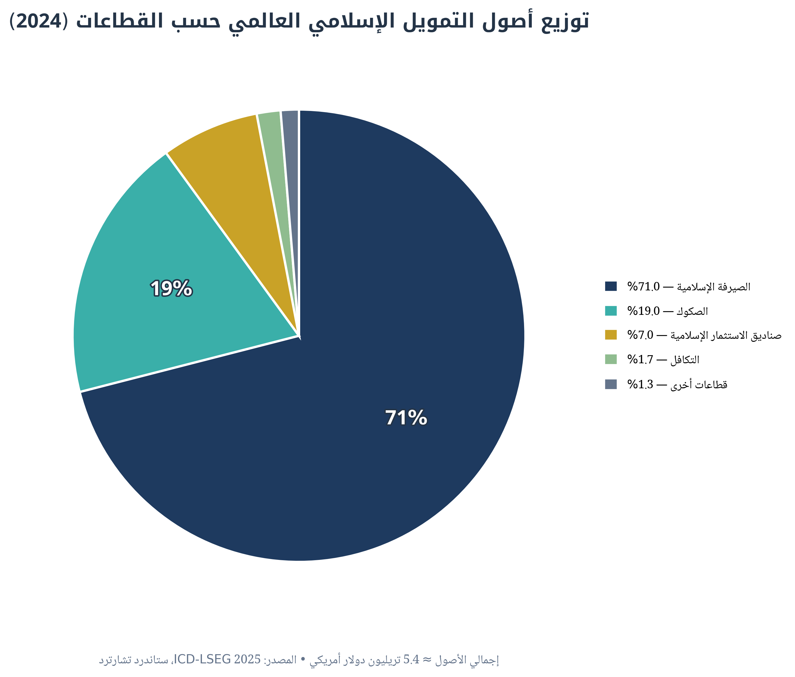
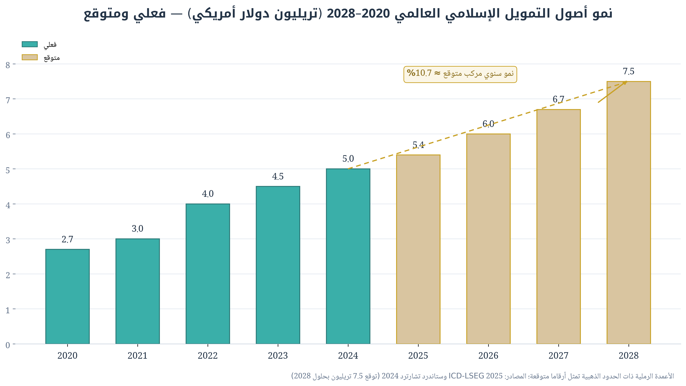
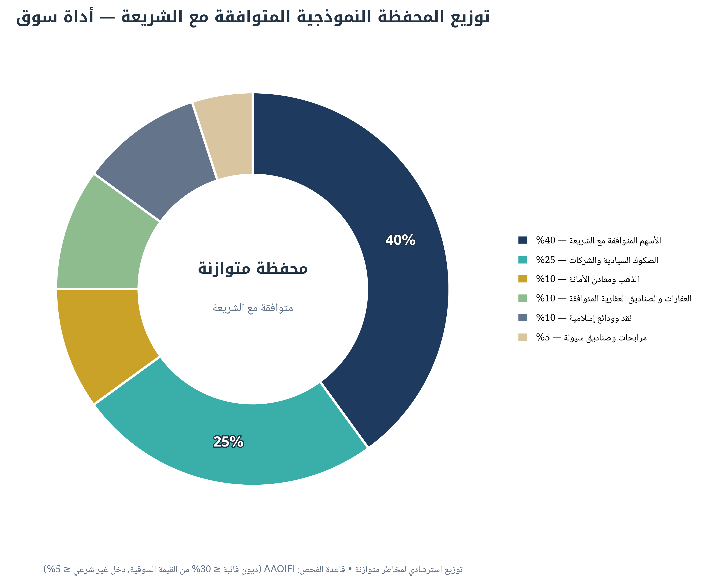

<div align="center">

# سُوق — Souq

### منصة التحليل والتداول المتوافق مع الشريعة | Sharia-Compliant Market Analysis & Trading Platform

[](https://nextjs.org)
[](https://www.typescriptlang.org)
[](https://tailwindcss.com)
[](./LICENSE)
[](#-الفاحص-الشرعي)

واجهة عربية بالكامل (RTL) • فحص شرعي وفق معايير AAOIFI • وكيل ذكاء اصطناعي مدرَّب على منهجية تداول إسلامية • حاسبة زكاة

</div>

---

## 📖 عن المشروع

**سُوق** هي أداة تحليل أسواق مالية مبنية على منهجية إسلامية متكاملة: لا مجرد شاشة أسعار، بل منظومة تحليل تبدأ بالفحص الشرعي قبل التحليل الفني والأساسي، وترشد المستخدم إلى أدوات متوافقة مع الشريعة مع الالتزام الصريح بتحريم **الربا** وال**غَرَر** و**الميسر**، وتوفير آليات **التطهير** و**حساب الزكاة**.

> **مبدأ النزاهة:** المنصة متصلة الآن بمصدر أسعار **حقيقي** (Yahoo Finance). الرمز الذي لا يوفره
> المصدر يظهر بحالة «غير متاح حاليًا» بشفافية تامة — **بدون أي أرقام مُختلقة إطلاقًا**، مع بيان
> المصدر وتوقيت آخر تحديث وحالة جلسة كل بورصة.

## ✨ الميزات

| الميزة | الوصف |
|---|---|
| 🕌 **الفاحص الشرعي (AAOIFI)** | فحص مزدوج: أنشطة محرَّمة (صفر تسامح) + نسب مالية (الديون ≤ 30% من القيمة السوقية، الدخل غير الشرعي ≤ 5%، النقد ≤ 33%) مع تصنيف ثلاثي: متوافق / مشروط / غير متوافق |
| 🤖 **الوكيل الذكي المدرَّب** | وكيل ذكاء اصطناعي بنظام تدريب من 4 طبقات: هوية خبير (CFA + AAOIFI) ← قواعد شرعية صارمة ← منهجية تحليل (شرعي ← أساسي ← فني ← إدارة مخاطر) ← أسلوب ردّ منظم مع إقرار إلزامي |
| 📈 **نظرة عامة على السوق** | أسعار **حقيقية حية** لمؤشرات (تاسي، دبي، داو جونز إسلامي، ناسداك، S&P) وأسهم خليجية وأمريكية + الذهب، مع Sparkline داخل اليوم وحالة الجلسة (مفتوح/مغلق) |
| ⭐ **قائمة المتابعة الدائمة** | تثبيت الأسهم بنجمة ذهبية محفوظة في قاعدة بيانات الخادم (SQLite عبر Prisma) مع تحديث تفاؤلي فوري |
| 💼 **محفظتي الفعلية + التطهير** | إدخال الحيازات (عدد/تكلفة/توزيعات) وتقييمها بأسعار حية، مع تطهير AAOIFI لكل سهم وإجماليات موحدة بالدولار (تحويل SAR=X الحي) وتقرير قابل للحفظ PDF |
| 📲 **PWA عربي** | قابل للتثبيت على الجوال (manifest RTL + أيقونات نجمة ثمانية) |
| 🧮 **حاسبة الزكاة** | حساب زكاة المحفظة (2.5%) بناءً على سعر الذهب للحد الأدنى (نِصاب 85 جراماً) |
| 📊 **التقارير السوقية** | تقارير بحثية مدعومة برسوم بيانية عربية بجودة النشر (300 DPI) |

## 🖼️ مخرجات التحليل البحثي

<div align="center">
  
  
  
</div>

*(أصول التمويل الإسلامي: 5.4 تريليون دولار 2024 ← 7.5 تريليون متوقعة 2028 — المصادر: ICD-LSEG 2025، ستاندرد تشارترد)*

## 🛰️ مصادر البيانات والنزاهة

| العنصر | التفاصيل |
|---|---|
| الأسهم والمؤشرات | Yahoo Finance (Chart API) — تحديث كل 60 ثانية مع كاش خادم 45 ثانية |
| الذهب | عقود `GC=F` الآنية — يُستخدم أيضًا لحساب نِصاب الزكاة فعليًا |
| التأخير الزمني | قد يتأخر سعر بعض الأصول حتى ~15 دقيقة وفق البورصة — يُعلن توقيت آخر تحديث دائمًا |
| حالات الجلسة | تقديرية من توقيت كل بورصة (السعودية أحد–خميس، دبي، نيويورك) |
| الرموز غير المتاحة | تظهر «غير متاح حاليًا» مع السبب — لا تزييف ولا أسعار وهمية |

## 🧱 التقنيات

- **Next.js 15** (App Router, Standalone Output) + **React 19**
- **TypeScript** + **Tailwind CSS 4** + **shadcn/ui**
- **Prisma ORM + SQLite** (حفظ دائم للمتابعة والحيازات — جاهز للترقية إلى PostgreSQL)
- **PWA** (manifest RTL + أيقونات مولّدة برمجياً)
- **z-ai-web-dev-sdk** لخدمة الوكيل الذكي (Backend only)
- **Python pipeline**: matplotlib + arabic-reshaper + python-bidi للرسوم العربية

## 🚀 التشغيل المحلي

```bash
# 1) الاستنساخ
git clone https://github.com/<USERNAME>/souq.git && cd souq

# 2) تثبيت الحزم (Bun مفضّل، أو pnpm/npm)
bun install

# 3) متغيرات البيئة
cp .env.example .env

# 4) توليد عميل Prisma
bun run db:generate

# 5) التشغيل
bun run dev        # http://localhost:3000
```

## ☁️ النشر

**Vercel (مستحسن):**
1. اربط المستودع على [vercel.com/new](https://vercel.com/new)
2. أضف متغير `DATABASE_URL` (استخدم Neon/PlanetScale وحدّث `provider` في `prisma/schema.prisma`)
3. أضف متغيرات مزود الذكاء الاصطناعي في إعدادات المشروع

**خادم خاص (Docker/VPS):** الإخراج `standalone` جاهز:
```bash
bun run build && node .next/standalone/server.js
```

## 📊 خط الرسوم البيانية العربية

إعادة توليد رسوم البحث الثلاثة بجودة النشر:
```bash
uv pip install matplotlib arabic-reshaper python-bidi
uv run python scripts/generate_arabic_charts.py
```

## 🗺️ خارطة الطريق

| المرحلة | النطاق | الحالة |
|---|---|---|
| **1** | استبدال بيانات المحاكاة بمصدر أسعار حقيقي (مؤشرات + أسهم) مع إعلان التأخير الزمني | ✅ **مكتملة** — Yahoo Finance حي مع كاش وبدائل |
| **2** | ربط الوكيل الذكي بالبيانات الحقيقية + حفظ المحافظ في قاعدة البيانات | ✅ **مكتملة** — Prisma/SQLite للمتابعة والحيازات + الوكيل بلقطة حية |
| **3** | حساب التطهير الفعلي لكل سهم + تقارير PDF للعميل | ✅ **مكتملة** — محرك تطهير AAOIFI + تقرير طباعة عربي RTL |
| **4** | تطبيق جوال (PWA) وتنبيهات لحظية | ✅ PWA قابل للتثبيت — التنبيهات اللحظية قيد العمل |

التفاصيل الكاملة في [وثيقة البحث والخطة](docs/souq-research-plan-ar.pdf).

## ⚖️ إقرار قانوني

هذه المنصة **أداة تعليمية وبحثية** ولا تُعد نصيحة استثمارية أو شرعية ملزمة. القرارات الاستثمارية مسؤولية المستخدم، ويُستحسن استشارة مستشار مالي ومستشار شرعي مؤهل. لا تضمن المنصة توافق أي أداة مع فتوى جهة معينة دون التحقق من الهيئة الشرعية المختصة.

## 📄 الرخصة

[RMIT](LICENSE) — خطوط Noto العربية تُوزَّع وفق [SIL Open Font License 1.1](fonts/OFL-NOTICE.txt).
